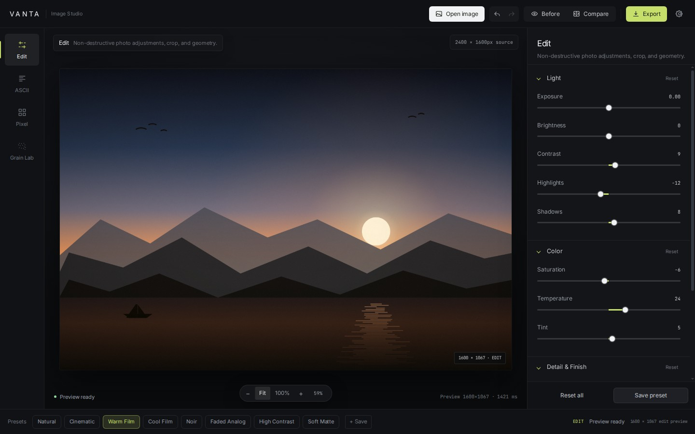
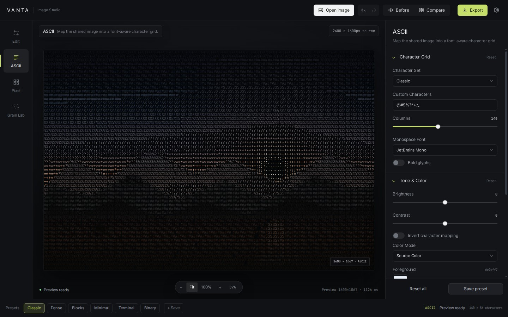
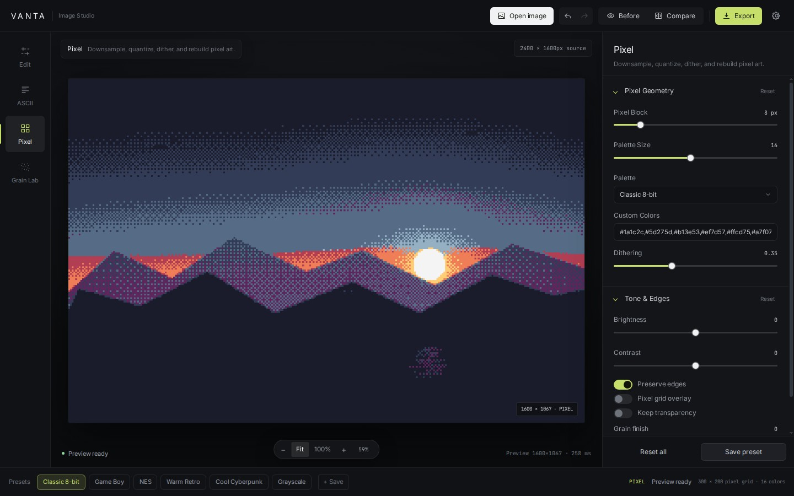
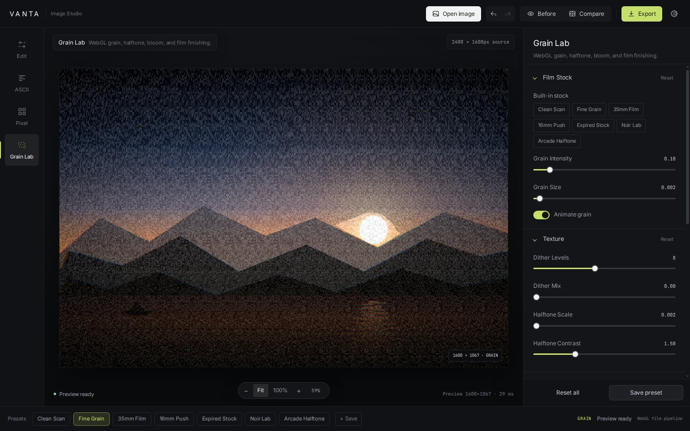

# VANTA Studio

A local-first browser studio for photo edits, ASCII art, pixel art, and WebGL film grain. Every control maps to a real processing stage, and every export is rebuilt from the original source image rather than from the preview.

**Live app:** [ishatxt.github.io/vanta](https://ishatxt.github.io/vanta/)



## Highlights

- **One shared image pipeline** across all four modes: source → crop/orientation → standard adjustments → creative mode → optional finish → preview or export.
- **Non-destructive editing** with 60-step undo/redo, including mode changes and saved-preset application.
- **Responsive editor** with a charcoal workspace, a floating fit/100% zoom dock, a draggable before/after split, and a mobile inspector sheet.
- **Local processing only.** Images are decoded in the browser and are never uploaded. Saved presets use `localStorage`.
- **Full-quality output.** Preview work is capped for speed; PNG/JPG/WEBP exports are rebuilt from the source with a 36 MP / 7000 px safety cap.
- **No package install or build step.** Native ES modules and relative paths work directly on GitHub Pages.

## Modes

| Edit | ASCII |
| --- | --- |
|  |  |
| **Pixel** | **Grain Lab** |
|  |  |

### Edit

Exposure, brightness, contrast, highlights, shadows, saturation, temperature, tint, sharpening, fade, and vignette. Crop to free, 1:1, 4:3, 3:2, 16:9, or 9:16; rotate in 90° steps; flip horizontally or vertically. Crop controls operate in the displayed, post-rotation image.

### ASCII

Character-set presets and custom characters, up to 300 columns, brightness/contrast, inversion, monochrome/source/terminal/amber/custom color modes, separate foreground and background colors, custom gradients, font choice, bold text, and grain finish. View, copy, or download the shared character grid as TXT.

### Pixel

Pixel block size, seven built-in palettes, palette-size reduction, custom color lists, ordered dithering, brightness/contrast, edge preservation, optional pixel-grid overlay, transparency, and grain finish. Preview and export use the same full-resolution block reference.

### Grain Lab

Seven film-stock presets plus grain intensity/size, animated grain, dither, halftone, exposure/color controls, chromatic aberration, pixelation, vignette, bloom, halation, light leaks, and dust/scratches. Rendering uses WebGL2 with a Canvas 2D fallback.

## Export

- **Edit / Pixel / Grain Lab:** PNG, JPG, WEBP.
- **ASCII:** PNG, JPG, WEBP, TXT, SVG.
- PNG preserves transparency where the mode supports it.
- JPG flattens transparency onto black.
- WEBP is only offered when the browser can encode it.
- Exports are generated from the current source and settings, with a progress state and measured preview timing in the status bar.

## Keyboard shortcuts

`Cmd` is supported in place of `Ctrl` on macOS.

| Action | Shortcut |
| --- | --- |
| Open image | `Ctrl+O` |
| Undo / redo | `Ctrl+Z` / `Ctrl+Shift+Z` or `Ctrl+Y` |
| Save current preset | `Ctrl+S` |
| Export | `Ctrl+E` |
| Toggle before view | `B` |
| Toggle compare split | `C` |
| Fit / 100% | `0` / `Shift+0` |
| Zoom out / in | `[` / `]` |
| Switch modes | `1`–`4` |
| Close menu or dialog | `Esc` |

## Run locally

No dependencies are required.

```bash
git clone https://github.com/ishatxt/vanta.git
cd vanta
python3 -m http.server 8123
```

Open `http://127.0.0.1:8123/`.

A local server is recommended instead of opening `index.html` directly: ES modules and clipboard access behave more consistently over HTTP. Use any static server if Python is unavailable.

## Project structure

```text
index.html              Application shell and dialogs
favicon.svg             Browser icon
css/                    Design tokens, layout, components, editor, responsive rules
js/app.js               Orchestration, rendering, history, presets, export UI
js/state.js             Defaults, mode definitions, palettes, presets, limits
js/image-pipeline.js    Geometry, adjustments, finish grain, export limits
js/modes/edit.js        Edit controls, crop ratios, rotation
js/modes/ascii.js       ASCII grid, canvas, TXT and SVG rendering
js/modes/pixel.js       Pixel sampling, palettes, dithering, reconstruction
js/modes/grain-lab.js   WebGL film engine and Canvas 2D fallback
js/preview.js           Fit/zoom, compare split, preview canvases
js/history.js           Snapshot history
js/presets.js           Validated localStorage presets
js/ui.js                Inspector, dialogs, status, toasts
js/export.js            Full-resolution export pipeline
docs/                   README screenshots
```

## Limits and browser support

- Source images are limited to **80 MP** and **12,000 px** on the longest edge.
- Exports are capped at **36 MP** and **7,000 px** on the longest edge to avoid browser memory failures. The export dialog reports when a source is capped.
- Previews use at most **1600 px** on the longest edge.
- Grain Lab requires WebGL2 for the full shader pipeline; unsupported browsers use a reduced Canvas 2D fallback.
- WEBP encoding, clipboard access, and some font rendering depend on the browser. Clipboard access requires HTTPS or `localhost`.
- EXIF/XMP metadata is not preserved. RAW formats and HEIC depend on browser decoding support.
- Animated grain is a live preview effect; exported images capture a single frame.
- Saved presets live in this browser only. They are validated when loaded, but clearing site data removes them.
- Very large exports may still exhaust memory on low-memory mobile devices.

## License

No license has been declared for this repository yet. Add one before redistributing or reusing the code.
